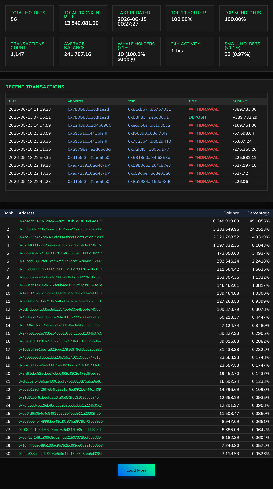
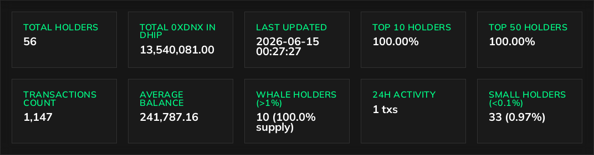
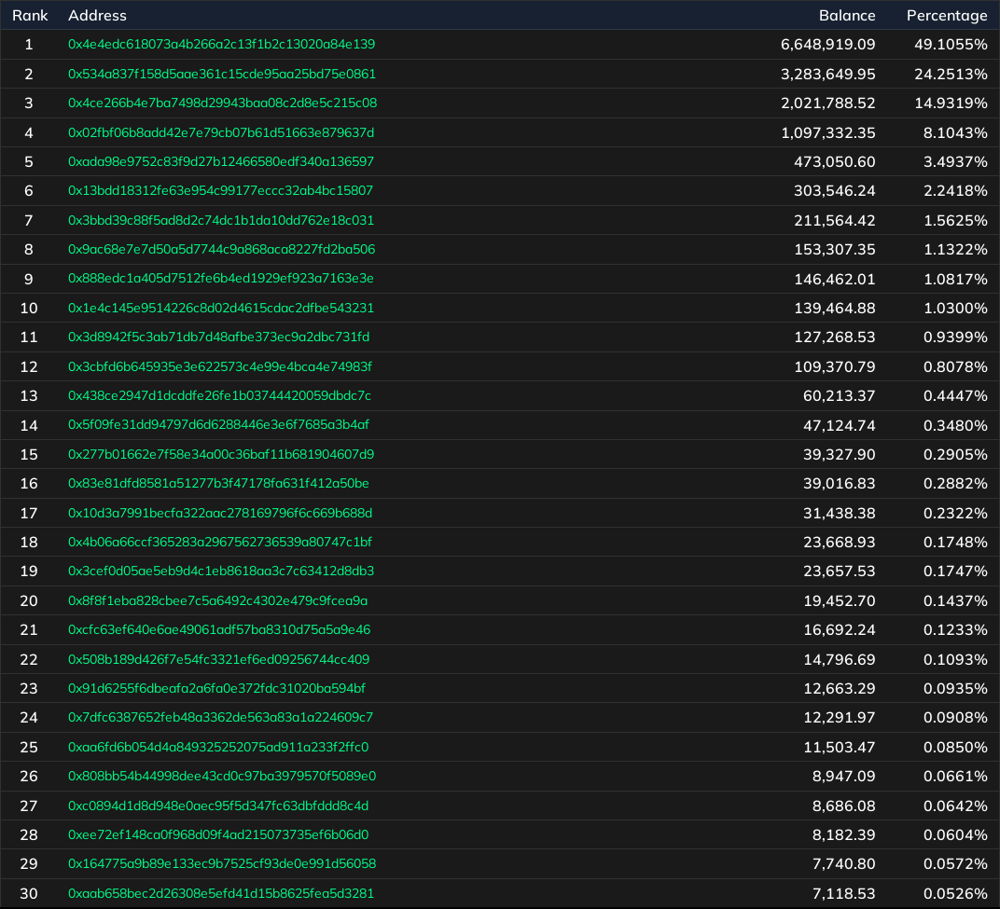
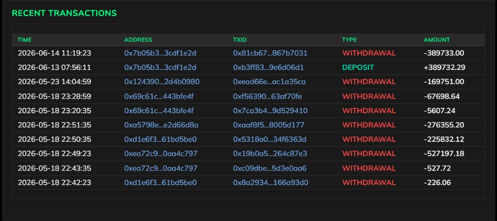
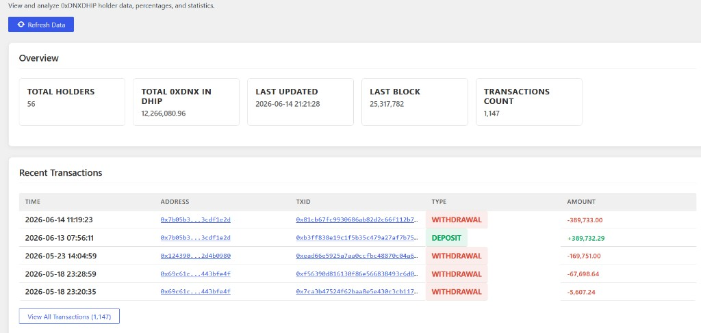
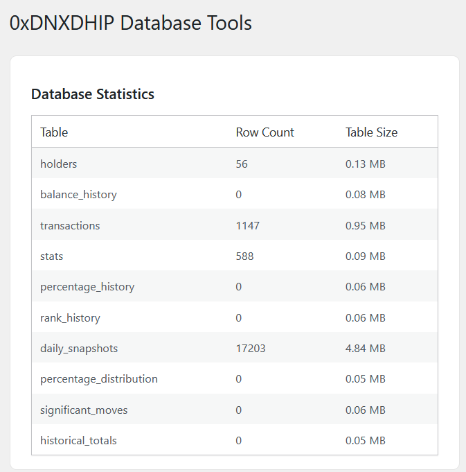
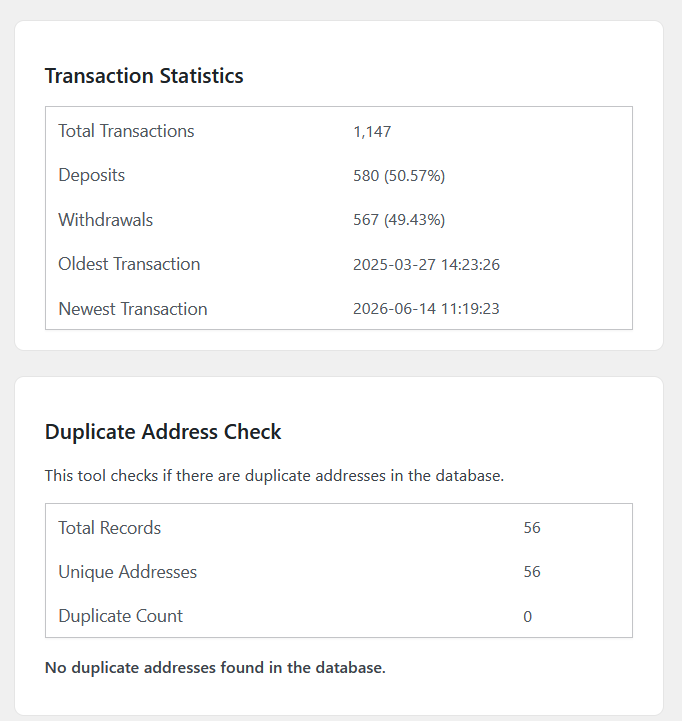
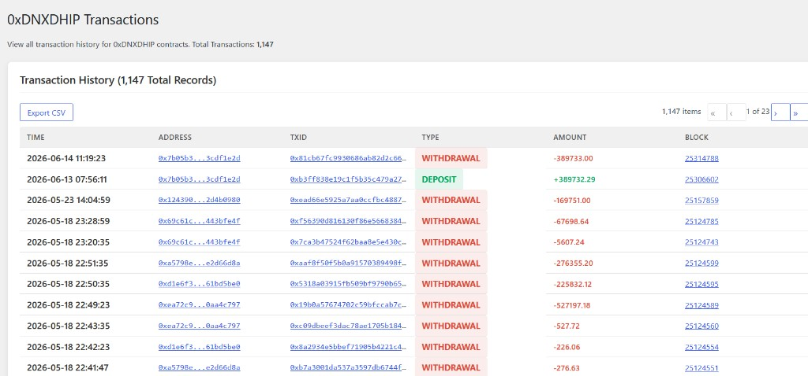

# 0xDNX DHIP Richlist

Holder rankings become more useful when they can be read alongside recent activity and summary information. The 0xDNX DHIP Richlist brings those views into a WordPress dashboard, helping visitors explore the supported asset's distribution without piecing together several pages.

## Tech stack

| Layer | Technologies |
|---|---|
| Application | PHP, WordPress |
| Supporting technologies | HTML, CSS, JavaScript; Dynex |

## Understand the distribution

Summary statistics provide a starting point before examining individual holders. The dashboard gives visitors an overview of the tracked balances and activity, helping place a single entry in the wider picture. It is a browsing and investigation tool.

## Explore ranked holders

The holder table supports working through the distribution in an ordered view. Address information and available navigation help follow an entry of interest, while live refresh keeps the displayed information useful during a session. Visitors can explore without repeatedly rebuilding the same search.

## Connect holders with activity

Recent transactions add movement to the static ranking. Reviewing activity beside holder information helps the visitor decide where to investigate further. The dashboard keeps the relevant reference information available for that next step.

## Publish the dashboard on WordPress

Embedding support gives the site owner a way to place the richlist within the site's presentation. Search-oriented page support helps the published information fit the wider site. The visitor-facing product remains a coherent dashboard.

## Operate and maintain the view

Administrator panels cover status, settings, transaction inspection and maintenance tools. These support checking whether the published view is healthy and investigating a data question. Two administrator captures are currently narrow and should be replaced with readable originals.

---

Private code: [dynex-0xdnx-dhip-richlist-plugin](https://github.com/logicencoder/dynex-0xdnx-dhip-richlist-plugin)

See [REPOS.md](REPOS.md) for related repositories.

**[Logic Encoder](https://logicencoder.com)** · [GitHub](https://github.com/logicencoder) · [Contact](https://logicencoder.com/contact/)
